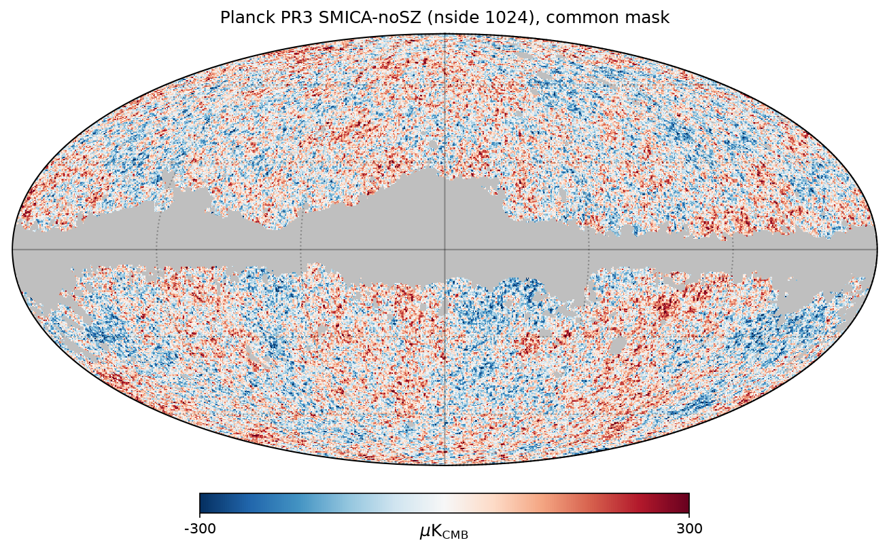
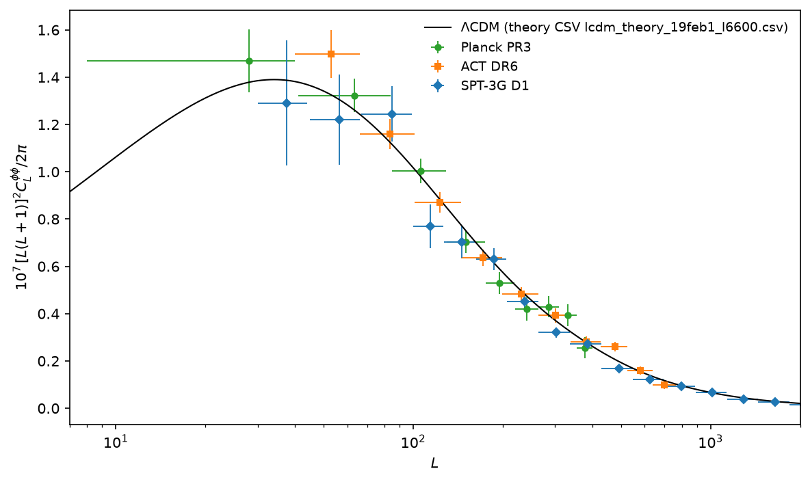
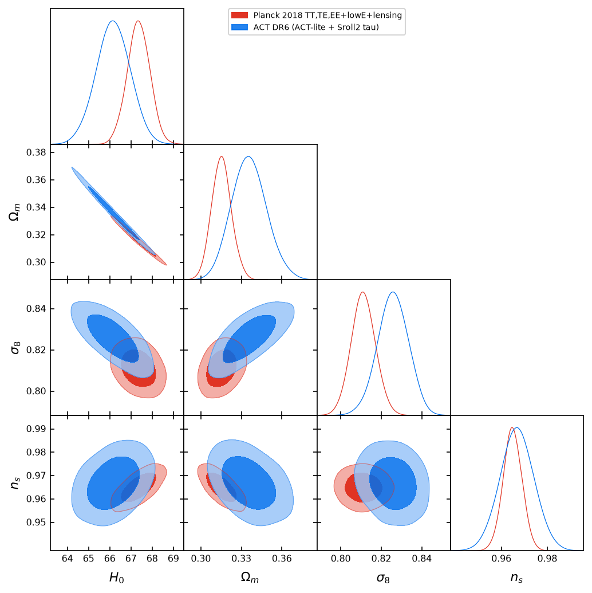
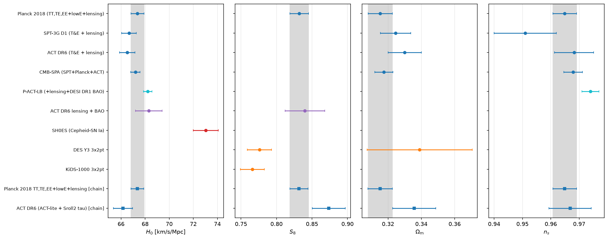

# cmb-data-mcp-server

MCP server for public CMB data: Planck PR3 component-separated maps, Planck PR3 / ACT DR6 / SPT-3G bandpowers and lensing bandpowers, and published chains.
An agent can measure its own TT spectrum from Planck maps, fetch released bandpowers with covariances and compute χ² against LCDM.
It can also make publication-style plots and compare with published constraints (for comparison only).

Part of the cosmo data MCP server family (sn · galaxy-surveys · cmb-data · weak-lensing · clusters). Default port: 8012.

## At a glance

| | |
|---|---|
| Surveys | Planck PR3 (maps, spectra, lensing, chains), ACT DR6 (spectra, lensing, chains), SPT-3G D1 (spectra, lensing), SPT-3G 2018 (spectra) |
| Tools | 20 (3 catalog, 5 summary statistic, 4 published result, 4 meta, 4 dispatch) |
| Skills | 6 (`skills/`) |
| Bundled data | 0.35 MB (Planck binned spectra and best-fit theory, SPT-3G spectra, Planck/ACT/SPT lensing, Planck margestats) |
| Network | `fetch_cmb_map` (first call per map); `fetch_cmb_spectrum`, `plot_cmb_spectra`, `compute_cmb_residuals` for `act_dr6` (and Planck `binned=False`); `fetch_cmb_chain`, `analyze_chain`, `plot_triangle`; `compare_with_published_constraints` with `chains` |

## Data

| Dataset | Kind | Content | Shape and type | Source | Access |
|---|---|---|---|---|---|
| `planck_pr3_maps` SMICA-noSZ | Catalog | CMB temperature map, μK_CMB, Galactic, 5′ beam (full, hm1, hm2) | map, HEALPix Nside 2048 NESTED, 50.3M pixels; full: 2 float columns (I_STOKES, I_STOKES_INP), halves: 1 | Planck 2018 IV, IRSA | Download (403 MB full, 201 MB per half), cached; downgraded copy Nside 128–1024 RING cached (50 MB at 1024) |
| `planck_pr3_maps` SMICA, Commander | Catalog | CMB I/Q/U maps (full, hm1, hm2) | map, HEALPix Nside 2048, I/Q/U | Planck 2018 IV, IRSA | Download (2.0 GB SMICA, 1.6 GB Commander), cached; header/range-verified only |
| `planck_pr3_maps` common masks | Catalog | Common intensity (TMASK) and polarisation masks | map, HEALPix Nside 2048, 1 column | Planck 2018 IV, IRSA | Download (201 MB), cached |
| `planck_pr3` binned spectra | Summary statistic | D_ℓ TT, TE, EE (ℓ ≥ 30) with ±1σ and best-fit column | table: TT 83 × 5, TE 66 × 5, EE 66 × 5 | Planck 2018 V, PLA (IRSA) | Bundled (0.2 MB) |
| `planck_pr3` low-ℓ BB | Summary statistic | D_ℓ BB, 2 ≤ ℓ ≤ 29 | table, 28 rows × 3 cols | Planck 2018 V, PLA (IRSA) | Bundled |
| `planck_pr3` unbinned spectra | Summary statistic | D_ℓ TT, TE, EE per ℓ, asymmetric errors | table: TT 2507 × 4, TE and EE 1995 × 4 (2 ≤ ℓ ≤ 1996) | Planck 2018 V, PLA (IRSA) | Download (0.1–0.2 MB each), cached |
| `planck_pr3` best-fit theory | Published result | Lensed LCDM TT, TE, EE, BB, PP of base_plikHM_TTTEEE_lowl_lowE_lensing, 2 ≤ ℓ ≤ 2508 | table, 2507 rows × 6 cols | Planck 2018 VI, PLA (IRSA) | Bundled |
| `act_dr6` ACT-lite | Summary statistic | CMB-only TT, TE, EE bandpowers, covariance, bandpower windows | vector (3 × 45) + matrix (135 × 135) + 3 windows (8500 ℓ each), sacc FITS | Louis+25, LAMBDA | Download (287 kB tar.gz, 9.6 MB FITS), cached |
| `spt3g_d1` | Summary statistic | MV foreground-cleaned TT, TE, EE bandpowers (plotting product, no covariance) | table: TT 52 × 3, TE 72 × 3, EE 72 × 3 | Camphuis+25, pole.uchicago.edu | Bundled |
| `spt3g_2018` | Summary statistic | MV TT, TE, EE bandpowers | table, 44 rows × 11 cols | Balkenhol+23, pole.uchicago.edu | Bundled |
| `planck_pr3_lensing` | Summary statistic | Conservative PP bandpowers, 8 ≤ L ≤ 400, CMB-marginalised covariance | table (9 × 7) + matrix (9 × 9) | Planck 2018 VIII, Cobaya supp. data | Bundled |
| `act_dr6_lensing` | Summary statistic | C_L^κκ bandpowers, bins, CMB-marginalised covariance (baseline 40 ≤ L ≤ 763) | vector (18) + table (18 × 5) + matrix (18 × 18) | Qu+24, Madhavacheril+24, LAMBDA | Bundled (extracted from a 361 MB tarball) |
| `spt3g_d1_lensing` | Summary statistic | GMV C_L^κκ bandpowers, covariance, windows | vector (17) + matrix (17 × 17) + table (2970 × 3, sparse windows) | SPT-3G D1 lensing, spt_candl_data | Bundled |
| `planck_pr3_chains` | Published result | Planck 2018 plikHM TTTEEE+lowl+lowE+lensing posterior | chain, 25225 samples × 96 cols (94 params), weighted; margestats bundled | Planck 2018 VI, PLA (IRSA) | Download (65 MB zip, not the 11 GB grid), cached |
| `act_dr6_chains` | Published result | ACT-lite and P-ACT-lite LCDM Cobaya chains | chain: ACT-lite 87427 × 27 cols, P-ACT-lite 90592 × 30 cols, weighted | Louis+25, Calabrese+25, LAMBDA | Download (5.5 MB / 7.1 MB tar.gz), cached |
| Published constraints table | Published result | H0, S8, Ωm, n_s, σ8 from 9 cited analyses (Planck, SPT-3G D1, ACT DR6, CMB-SPA, P-ACT-LB, ACT lensing + BAO, SH0ES, DES Y3, KiDS-1000) | table, 9 entries (in code) | Cited papers | Bundled (`tools/chains/published.py`) |

### Where the data comes from
- Bundled: small text files in `data/` (0.35 MB). Spectrum, lensing and theory tools work offline with these. Provenance is in `data/README.md`.
- Download: maps, Planck unbinned spectra, the ACT DR6 sacc file and all chains are fetched once over HTTPS and cached in `~/.cache/cosmo-mcp/cmb-data-mcp-server/` (override with `$COSMO_MCP_DATA`). URLs were verified on 2026-11-04.
- Maps come from IRSA with resumable parallel range requests. No official Nside-1024 PR3 map exists, so the Nside-2048 file always downloads first. The downgraded map and mask are cached, so later calls are instant.
- No tool queries a live database. Pre-fetch by calling `fetch_cmb_map`, `fetch_cmb_spectrum(dataset="act_dr6")` and `fetch_cmb_chain` once.
- Published results (best-fit theory, chains, constraints table) are for comparison only. Results carry `metadata["comparison_only"]`.

## Tools

### Catalog tools

| Tool | What it does | Data used | Output | Weight |
|---|---|---|---|---|
| `fetch_cmb_map` | Downloads one Planck PR3 SMICA-noSZ, SMICA or Commander map (full, hm1 or hm2) and a common mask, and downgrades both to Nside 128–1024 (RING, Galactic, μK). | `planck_pr3_maps` (Download) | Map and mask FITS, JSON with rms in the mask and fsky | heavy |
| `measure_cmb_power_spectrum` | Measures TT (optionally EE, TE, BB) from a map: masked pseudo-C_ℓ / fsky with beam and pixel-window correction, Δℓ = 30 bins, Knox errors. Auto or hm1 × hm2 cross; `method="namaster"` if pymaster is installed. | Maps from `fetch_cmb_map`; `planck_pr3` binned TT (Bundled) for comparison | Binned CSV, npz, JSON, PNG vs released Planck TT | heavy |
| `plot_cmb_map` | Draws a Mollweide (Galactic) map with masked pixels grey and reports the pixel rms in the mask. | Map and mask from `fetch_cmb_map` | PNG | light |

### Summary statistic tools

| Tool | What it does | Data used | Output | Weight |
|---|---|---|---|---|
| `fetch_cmb_spectrum` | Writes one TT, TE, EE, BB or PP bandpower spectrum as a tidy CSV (ell, D_ell, errors). Saves the covariance when the release has one. | `planck_pr3` (Bundled / Download), `act_dr6` (Download), `spt3g_d1`, `spt3g_2018`, lensing sets (Bundled) | CSV (+ `_cov.npy`) | light |
| `plot_cmb_spectra` | Overlays D_ℓ bandpowers of one or more experiments with best-fit LCDM and a residual panel. | Spectrum datasets; theory CSV or bundled Planck best fit | PNG | light |
| `compute_cmb_residuals` | Computes χ², N and PTE of one experiment against a theory spectrum. Uses full covariance and windows for ACT DR6 and lensing; diagonal (indicative) for Planck and SPT. | Spectrum datasets; theory CSV or bundled Planck best fit | Residual CSV, χ² JSON | light |
| `compute_lcdm_theory_spectrum` | Computes lensed LCDM TT, TE, EE, BB and PP with camb from your parameters. Without camb and params it returns the bundled Planck 2018 best fit, flagged as a published result. | camb (optional) or `planck_pr3` best-fit theory (Bundled) | Theory CSV | heavy |
| `plot_lensing_spectrum` | Plots Planck, ACT and SPT lensing bandpowers with LCDM and fits A_lens per experiment with the full covariance. | `planck_pr3_lensing`, `act_dr6_lensing`, `spt3g_d1_lensing` (Bundled) | PNG, A_lens ± σ per dataset | light |

### Published result tools

| Tool | What it does | Data used | Output | Weight |
|---|---|---|---|---|
| `fetch_cmb_chain` | Downloads and extracts one published chain and lists its parameters. | `planck_pr3_chains`, `act_dr6_chains` (Download) | getdist chain root, summary JSON | light |
| `analyze_chain` | Computes getdist marginal statistics (mean, std, 68/95% limits) of a published chain. | `planck_pr3_chains`, `act_dr6_chains` (Download) | `chain_stats_<chain>` CSV and JSON | heavy |
| `plot_triangle` | Draws a getdist triangle plot of up to 3 published chains. | `planck_pr3_chains`, `act_dr6_chains` (Download) | PNG | light |
| `compare_with_published_constraints` | Draws a whisker plot of H0, S8, Ωm, n_s, σ8 from cited tables and optional chains, with Gaussian n-σ tension to a reference. | Published constraints table (Bundled); chains (Download, optional) | PNG, `parameter_whisker.csv` | light |

### Meta and dispatch tools

| Tool | What it does | Data used | Output | Weight |
|---|---|---|---|---|
| `list_cmb_datasets` | Lists datasets by kind, with access and the tools that read them. | Registry | JSON | light |
| `describe_cmb_dataset` | Describes one dataset: products, units, conventions, URLs, citation. | Registry | JSON | light |
| `list_cmb_skills` | Lists the skills (multi-tool recipes). | `skills/` | JSON | light |
| `load_cmb_skill` | Returns the full instructions of one skill. | `skills/` | Text | light |
| `auth_status` | Reports whether this server is signed in to ALCF/NERSC for HPC dispatch. | none | JSON | light |
| `get_dispatch` | Reports where heavy tools run now (local or an HPC facility). | none | JSON | light |
| `set_dispatch` | Sets where heavy tools run: local, polaris (ALCF) or perlmutter (NERSC). | none | JSON | light |
| `export_dispatch_pack` | Exports this server's compute kernels so a client can run them on HPC. | `tools/` | Files + manifest | light |

## Example figures

| | |
|---|---|
|  |  |
| Planck PR3 SMICA-noSZ map, Nside 1024, common mask (`plot_cmb_map`) | TT from SMICA-noSZ hm1 × hm2 vs released Planck TT (`measure_cmb_power_spectrum`) |
|  |  |
| Planck, ACT DR6 and SPT-3G D1 TT with LCDM (`plot_cmb_spectra`) | Planck, ACT and SPT lensing bandpowers (`plot_lensing_spectrum`) |
|  |  |
| Planck 2018 vs ACT DR6 LCDM chains (`plot_triangle`) | H0, S8, Ωm, n_s whiskers (`compare_with_published_constraints`) |

## Validation

| Check | This server | Reference |
|---|---|---|
| Map → TT, first peak | SMICA-noSZ hm1 × hm2, Nside 1024, common mask (1° apodisation, fsky_w2 = 0.752), lmax 2000: ℓ = 225, D_ℓ = 5706 μK² | Planck released 5793 μK² in that bin |
| Map → TT vs released TT, 30 < ℓ < 1500 | Median ratio 1.023, rms deviation 4.7%, max 10%; within ±4% for 100 < ℓ < 1000; ℓ ≈ 48 bin −6.5%; ℓ ≈ 1000–1500 +4–10% | Planck PR3 TT binned R3.01 |
| Full-mission auto-spectrum | Within ≈ 3% below ℓ ~ 900; noise bias grows to +27% at ℓ ≈ 1500 | Planck PR3 TT binned R3.01 |
| Map rms in mask | 106.9 μK at Nside 1024 | Real run, 2026-11-04 |
| Planck TT binned vs best fit | χ² ≈ 82.7 for 83 bandpowers | PLA best-fit theory |
| Lensing A_lens | Planck 1.01 ± 0.03, ACT 1.02 ± 0.03 | 1 for LCDM |
| Planck 2018 chain (getdist) | H0 = 67.36 ± 0.54, Ωm = 0.3153 ± 0.0073, σ8 = 0.8111 ± 0.0060 | PLA margestats (`tests/test_cmb.py`) |
| Tensions vs Planck 2018 | SH0ES H0 4.9σ; KiDS S8 −3.1σ; DES Y3 S8 −2.6σ | Riess+22, Heymans+21, DES Y3 (2022) |

## Skills

| Skill | Use it to |
|---|---|
| `cmb-tour` | Run map → own spectrum → own LCDM χ² → published comparison, with expected numbers. |
| `planck-map-to-power-spectrum` | Download Planck half-mission maps, measure TT yourself and validate against the released bandpowers. |
| `reproduce-planck-tt-spectrum` | Reproduce the Planck 2018 TT/TE/EE figure with best-fit LCDM, residuals and χ². |
| `cmb-experiment-comparison` | Compare Planck, ACT DR6 and SPT-3G bandpowers, χ², lensing amplitudes and chains. |
| `h0-s8-tension-whisker` | Build the H0 / S8 / Ωm / n_s whisker plot and quantify tensions (published results, comparison only). |
| `hpc-dispatch-handoff` | Run heavy kernels on ALCF Polaris or NERSC Perlmutter. |

## Install and run

```bash
python -m venv .venv && .venv/bin/pip install -e ".[dev]"
.venv/bin/pip install -e ".[theory]"            # optional: camb for compute_lcdm_theory_spectrum
.venv/bin/pip install -e ".[namaster]"          # optional: pymaster (no macOS x86_64 wheel)
.venv/bin/python -m mcp_server                 # stdio (or ./run_server.sh)
.venv/bin/python -m mcp_server --transport streamable-http --port 8012
MPLBACKEND=Agg .venv/bin/python -m pytest -q    # tests (network tests: -m network)
```

## Limitations

- No compiled likelihoods. HiLLiPoP/LoLLiPoP (Planck PR4), act_dr6_lenslike, ACT MFLike and candl (SPT) are not wrapped yet.
- Planck and SPT-3G D1 spectra are release plotting products without covariance. Their χ² is diagonal-only and indicative.
- ACT DR6 χ² fixes the calibration A_act = P_act = 1.
- SPT-3G D1 lensing gives A_lens ≈ 0.92. The candl lensing-systematics emulator and M_L corrections are not applied. This is a known bias, not a physical result.
- The bundled theory stops at ℓ = 2508. ACT/SPT bins above that need camb (`lmax=6600`).
- ACT chain Ωm assumes Σmν = 0.06 eV. ACT burn-in is 0.3, since LAMBDA lists none for the lite chains.
- `smica` and `commander` I/Q/U maps are implemented but only header/range-verified. Polarisation spectra from maps are not validated.
- `measure_cmb_power_spectrum` (anafast) has no mode-coupling inversion, Knox cosmic-variance errors only, and no noise or foreground model.
- Not yet available: Planck PR3 lensing κ map (723 MB; IRSA served it at < 0.1 MB/s), ACT DR6 maps and κ map, PR4 (NPIPE) maps, SPT-3G D1 maps, cutouts and cross-correlation with galaxy surveys.

## Citation

- Planck PR3 maps: Planck Collaboration 2020, A&A 641, A4 (arXiv:1807.06208).
- Planck PR3 spectra and best fit: Planck Collaboration 2020, A&A 641, A5 (arXiv:1907.12875); A&A 641, A6 (arXiv:1807.06209).
- Planck PR3 lensing: Planck Collaboration 2020, A&A 641, A8 (arXiv:1807.06210).
- Planck 2018 chains: Planck Collaboration 2020, A&A 641, A6 (arXiv:1807.06209).
- ACT DR6 spectra and chains: Louis et al. 2025 (arXiv:2503.14452); Calabrese et al. 2025 (arXiv:2503.14454).
- ACT DR6 lensing: Qu et al. 2024, ApJ 962, 112 (arXiv:2304.05202); Madhavacheril et al. 2024 (arXiv:2304.05203).
- SPT-3G D1: Camphuis et al. 2025 (arXiv:2506.20707).
- SPT-3G 2018: Balkenhol et al. 2023, PRD 108, 023510 (arXiv:2212.05642).
- SPT-3G D1 lensing: arXiv:2608.31136 (via spt_candl_data).
- Published constraints: citations per entry in `tools/chains/published.py`.
