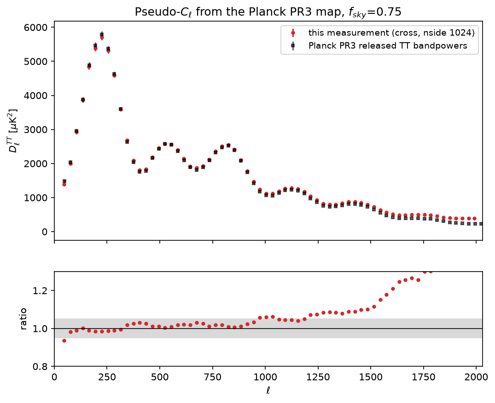

# CMB Data MCP Server

MCP server for **public CMB data organised by data tier**: Planck PR3 component-separated
**maps** (tier 1) and your own power spectrum measured from them; Planck PR3 / ACT DR6 /
SPT-3G **bandpowers with covariances and lensing bandpowers** (tier 2); and **published
chains / best-fit theory** (tier 3, comparison only). It covers data access, honest chi2
checks against LCDM, publication-style plots, and cross-experiment comparisons. It is part
of the cosmo-*-mcp-server family (see `docs/CONVENTIONS.md`).

No compiled likelihoods yet (see the TODO list below).




## Data tiers
Tier 1 = maps; tier 2 = summary statistics with covariance (measured from tier 1);
tier 3 = published inference (chains, best fits), **comparison only**: never used as a
measurement or prior. The server prefixes every tool description with its tier, and results
carry `metadata["data_tier"]` (tier 3 also gets a `tier3_notice`).

| dataset | tier 1 | tier 2 | tier 3 (comparison only) | access |
|---|---|---|---|---|
| `planck_pr3_maps` | SMICA-noSZ T, SMICA I/Q/U, Commander I/Q/U (full, hm1, hm2); common T/P masks | pseudo-C_ell TT (EE/TE/BB) measured by `measure_cmb_power_spectrum` | – | download on demand from IRSA (resumable parallel ranges; 201 MB–2.0 GB at nside 2048), ud_graded to nside 128–1024 and cached |
| `planck_pr3` | – | binned/unbinned TT, TE, EE, low-ell BB | PLA best-fit (minimum) theory spectra | bundled binned + theory; unbinned downloaded |
| `act_dr6` | – | ACT-lite TT/TE/EE, 135×135 covariance, windows | – | download (287 kB) |
| `spt3g_d1` | – | MV TT/TE/EE | – | bundled |
| `spt3g_2018` | – | TT/TE/EE | – | bundled |
| `planck_pr3_lensing` | – | PP bandpowers, 9×9 covariance | – | bundled |
| `act_dr6_lensing` | – | C_L^kk, 18×18 covariance | – | bundled |
| `spt3g_d1_lensing` | – | C_L^kk, 17×17 covariance, windows | – | bundled |
| `planck_pr3_chains` | – | – | posterior chains, margestats | download (65 MB) |
| `act_dr6_chains` | – | – | ACT-lite / P-ACT chains | download (5–7 MB) |

`compute_lcdm_theory_spectrum(params=...)` with camb is a model computation from *your*
parameters (tier 2 tool); without camb it falls back to the published Planck best fit and
flags it `model_tier: 3`.

## Tools (16 science/meta + 4 dispatch)
| tool | what it does |
|---|---|
| `list_cmb_datasets` / `describe_cmb_dataset` | dataset registry: products, units, verified URLs, citations |
| `list_cmb_skills` / `load_cmb_skill` | server-side recipes (also exposed as MCP prompts) |
| **tier 1** | |
| `fetch_cmb_map` (heavy) | Planck PR3 SMICA-noSZ / SMICA / Commander map (full or half-mission) + common mask, downloaded once and ud_graded to nside 128–1024 (cached, muK, RING, Galactic). Dispatch kernel `prepare_cmb_map` |
| `plot_cmb_map` | Mollweide PNG with the mask greyed out, rms in the mask |
| `measure_cmb_power_spectrum` (heavy) | **tier 1 → 2**: masked pseudo-C_ell (healpy anafast; `method="namaster"` if pymaster is installed) with apodisation, fsky=<w²>, 5′ beam and pixel-window deconvolution, Δℓ=30 PLA binning, Knox errors; auto or hm1×hm2 cross; plots and compares against the released Planck TT. Dispatchable |
| **tier 2** | |
| `fetch_cmb_spectrum(dataset, spectrum, binned)` | TT/TE/EE/BB/PP bandpowers written to a tidy CSV (+ covariance `.npy` when released) |
| `plot_cmb_spectra` | D_ell with errors, multi-experiment overlay, best-fit LCDM, residual panel |
| `compute_cmb_residuals` | chi2 / PTE against a theory spectrum. Uses the full covariance and windows for ACT and lensing; diagonal (indicative) for Planck/SPT plotting products |
| `compute_lcdm_theory_spectrum` (heavy) | camb LCDM spectra from your parameters (optional dependency, lazy import, dispatchable). Falls back to the bundled Planck 2018 best-fit file (tier 3, flagged) |
| `plot_lensing_spectrum` | Planck/ACT/SPT [L(L+1)]^2 C_L^phiphi/2pi with LCDM, plus a fitted A_lens per experiment |
| **tier 3 (comparison only)** | |
| `fetch_cmb_chain` | downloads and extracts ONE public chain (Planck 2018 plikHM TTTEEE+lowl+lowE+lensing, 65 MB; ACT DR6 ACT-lite / P-ACT, 5–7 MB) |
| `analyze_chain` (heavy) | getdist marginal stats (mean, std, 68/95% limits). Dispatch kernel downloads the chain on the node |
| `plot_triangle` | getdist triangle plot overlaying up to 3 chains |
| `compare_with_published_constraints` (renamed from `compare_parameter_constraints`) | whisker plot of H0/S8/Om/ns/sigma8 from chains and cited published tables, with n-sigma tensions |
| `set_dispatch` / `get_dispatch` / `auth_status` / `export_dispatch_pack` | hep-genesis IRI dispatch (family convention) |

## Datasets (details)
| key | access | content |
|---|---|---|
| `planck_pr3_maps` | on demand (IRSA) | `COM_CMB_IQU-{smica-nosz,smica,commander}_2048_R3.00_{full,hm1,hm2}.fits`, `COM_Mask_CMB-common-Mask-{Int,Pol}_2048_R3.00.fits` |
| `planck_pr3` | bundled binned spectra + best-fit theory; unbinned spectra downloaded | PLA R3.01/R3.02 TT/TE/EE, low-ell BB, base_plikHM_TTTEEE_lowl_lowE_lensing minimum theory |
| `act_dr6` | download (287 kB) | ACT DR6 CMB-only (ACT-lite) sacc: 135 bandpowers, covariance, windows |
| `spt3g_d1` | bundled | SPT-3G D1 MV foreground-cleaned TT/TE/EE |
| `spt3g_2018` | bundled | SPT-3G 2018 TT/TE/EE MV bandpowers |
| `planck_pr3_lensing` | bundled | 2018 conservative lensing bandpowers + CMB-marginalised covariance |
| `act_dr6_lensing` | bundled (extracted from the 361 MB tarball) | DR6 lensing baseline bins + covariance |
| `spt3g_d1_lensing` | bundled | D1 GMV lensing bandpowers, covariance, windows |
| `planck_pr3_chains` | download (65 MB) | single-family PLA zip, not the 11 GB grid |
| `act_dr6_chains` | download | ACT-lite and P-ACT-lite LCDM Cobaya chains |

Provenance for every bundled file is in `data/README.md`.

## Sanity checks (verified by tests)
- **Map → spectrum (real run, 2026-11-04):** SMICA-noSZ hm1×hm2 at nside 1024, common mask
  (1° apodisation, fsky_w2 = 0.752), lmax 2000: first peak at **ℓ = 225, D_ℓ = 5706 μK²**
  (Planck released 5793 μK² in that bin). Ratio to the released Planck TT bandpowers over
  30 < ℓ < 1500: **median 1.023, rms deviation 4.7 %, max 10 %**: within ±4 % for 100 < ℓ < 1000;
  the lowest bin (ℓ ≈ 48) is −6.5 % (cosmic variance plus the fsky approximation) and ℓ ≈ 1000–1500 sits
  +4–10 % high (unmodelled residual foregrounds/point sources and no mode-coupling inversion). The full-mission auto-spectrum agrees to ≈3 % below
  ℓ ~ 900, but noise bias then grows to +27 % at ℓ ≈ 1500. Use the half-mission cross.
  Map rms in the mask is 106.9 μK at nside 1024. Download: 600 MB in ~6 min (0.8–1.2 MB/s).
- Planck 2018 chain: **H0 = 67.36 ± 0.54, Ωm = 0.3153 ± 0.0073, σ8 = 0.8111 ± 0.0060**
  (getdist output equals the PLA margestats).
- Planck TT binned vs best fit: χ² ≈ 82.7 for 83 points. Lensing A_lens: Planck 1.01 ± 0.03, ACT 1.02 ± 0.03.
- SH0ES vs Planck H0: 4.9σ. KiDS S8: −3.1σ. DES Y3 S8: −2.6σ.

## Skills
`cmb-tour` (tier 1 → 2 → own fit → compare), `planck-map-to-power-spectrum` (tier 1 → 2, new),
`reproduce-planck-tt-spectrum`, `cmb-experiment-comparison`,
`h0-s8-tension-whisker` (**tier 3, comparison only**), `hpc-dispatch-handoff`.

## Install / run
```bash
uv venv --python 3.12 .venv && uv pip install --python .venv/bin/python -e ".[dev]"
uv pip install --python .venv/bin/python --only-binary :all: camb   # optional (".[theory]")
uv pip install --python .venv/bin/python --only-binary :all: pymaster  # optional (".[namaster]"; Linux/arm64 wheels)
.venv/bin/python -m mcp_server --transport stdio            # or ./run_server.sh
.venv/bin/python -m mcp_server --transport streamable-http --port 8012
MPLBACKEND=Agg .venv/bin/python -m pytest -q                # -m "not network" offline
```

## Known limitations
- The Planck and SPT-3G D1 spectra are the release *plotting* products, which ship no
  covariance. Their χ² values are diagonal-only and indicative.
- ACT DR6 χ² fixes A_act = P_act = 1.
- The SPT-3G D1 lensing A_lens comes out ≈ 0.92. candl's lensing-systematics emulator and
  M_L response corrections are not applied, so this is a known bias, not a physical result.
- The bundled theory stops at ℓ = 2508. ACT/SPT bins beyond that need camb (`lmax=6600`).
- ACT chain Ωm is derived assuming Σmν = 0.06 eV. ACT burn-in is 0.3, since LAMBDA lists none for the lite chains.
- Maps: there is no official nside-1024 PR3 SMICA map (PR2 had one), so the 2048 file is always
  downloaded first and then downgraded. `smica_nosz` (403 MB, T only) is the default; Q/U needs `smica`
  (2.0 GB) or `commander` (1.6 GB), which are implemented but were only HEAD/range-verified here.
- `measure_cmb_power_spectrum` uses pseudo-C_ell/fsky with no mode-coupling inversion (use
  `method="namaster"` where pymaster installs) and Knox cosmic-variance errors (no noise term,
  no foreground model). Polarisation spectra from SMICA are implemented but not validated.

## TODO — Phase 2: pip likelihoods (not implemented)
- Planck: **HiLLiPoP** (PR4 high-ℓ TT/TE/EE) and **LoLLiPoP** (PR4 low-ℓ EE/BB), via `planck-npipe` / cobaya.
- ACT: **act_dr6_lenslike** (full lensing likelihood with linear corrections), plus the ACT DR6 multi-frequency MFLike.
- SPT: **candl** + `spt_candl_data` (SPT-lite TT/TE/EE and D1 lensing with its systematics emulator).
- Tools: `evaluate_cmb_likelihood(theory_file, likelihood)`, plus a profile likelihood in one parameter (heavy, dispatchable).

## TODO — more maps
- Done: Planck PR3 SMICA/Commander maps, masks, and the power spectrum from maps.
- Not yet: the Planck PR3 lensing κ alm (`COM_Lensing_4096_R3.00.tgz`, 723 MB, URL HEAD-verified;
  IRSA served it at <0.1 MB/s during development, so no tool reads it yet), ACT DR6 maps / κ map (pixell),
  PR4 (NPIPE) maps, SPT-3G D1 maps, cutouts, and cross-correlation with galaxy surveys.
