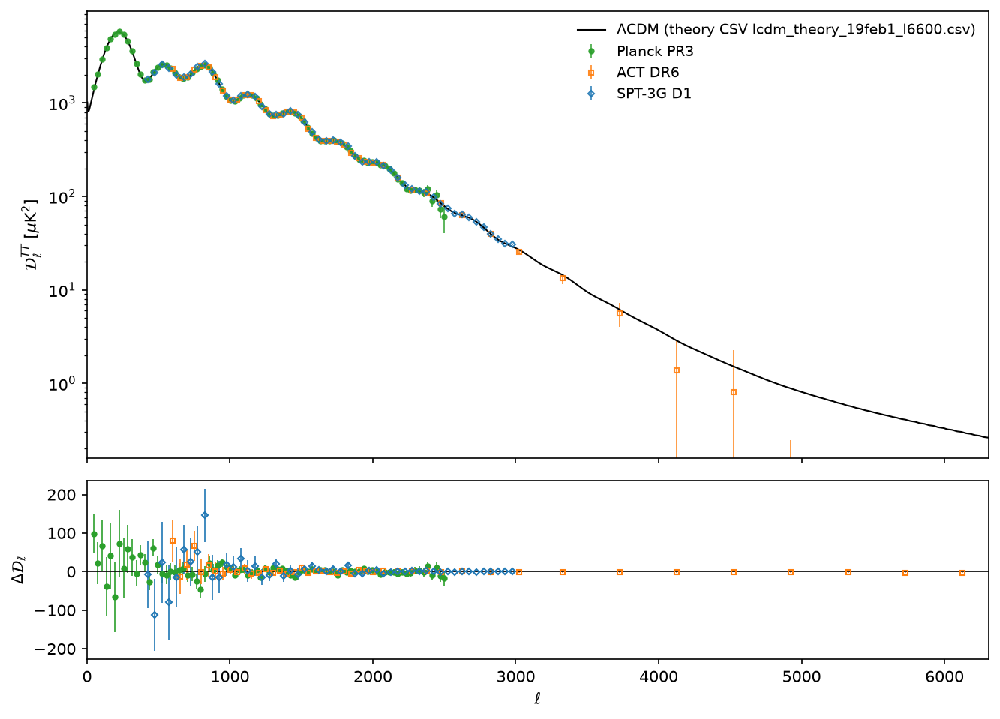

# CMB Data MCP Server

MCP server for **public CMB power spectra, lensing bandpowers and LCDM parameter chains**
from Planck PR3 (2018), ACT DR6 and SPT-3G (D1 + 2018). It covers data access, quick and honest
chi2 checks against LCDM, publication-style plots, and cross-experiment comparisons. It is
part of the cosmo-*-mcp-server family (see `docs/CONVENTIONS.md`).

This is Phase 1 of `~/cmb_mcp_data_survey.md`: spectra and chains only. It has no maps and
no compiled likelihoods (see the TODO list below).



## Tools (13 science/meta + 4 dispatch)
| tool | what it does |
|---|---|
| `list_cmb_datasets` / `describe_cmb_dataset` | dataset registry: products, units, verified URLs, citations |
| `list_cmb_skills` / `load_cmb_skill` | server-side recipes (also exposed as MCP prompts) |
| `fetch_cmb_spectrum(dataset, spectrum, binned)` | TT/TE/EE/BB/PP bandpowers written to a tidy CSV (+ covariance `.npy` when released) |
| `plot_cmb_spectra` | D_ell with errors, multi-experiment overlay, best-fit LCDM, residual panel |
| `compute_cmb_residuals` | chi2 / PTE against a theory spectrum. Uses the full covariance and windows for ACT and lensing; diagonal (indicative) for Planck/SPT plotting products |
| `compute_lcdm_theory_spectrum` (heavy) | camb LCDM spectra (optional dependency, lazy import, dispatchable). Falls back to the bundled Planck 2018 best-fit file |
| `plot_lensing_spectrum` | Planck/ACT/SPT [L(L+1)]^2 C_L^phiphi/2pi with LCDM, plus a fitted A_lens per experiment |
| `fetch_cmb_chain` | downloads and extracts ONE public chain (Planck 2018 plikHM TTTEEE+lowl+lowE+lensing, 65 MB; ACT DR6 ACT-lite / P-ACT, 5–7 MB) |
| `analyze_chain` (heavy) | getdist marginal stats (mean, std, 68/95% limits). Dispatch kernel downloads the chain on the node |
| `plot_triangle` | getdist triangle plot overlaying up to 3 chains |
| `compare_parameter_constraints` | whisker plot of H0/S8/Om/ns/sigma8 from chains and cited published tables, with n-sigma tensions |
| `set_dispatch` / `get_dispatch` / `auth_status` / `export_dispatch_pack` | hep-genesis IRI dispatch (family convention) |

## Datasets
| key | access | content |
|---|---|---|
| `planck_pr3` | bundled binned spectra + best-fit theory; unbinned spectra downloaded | PLA R3.01/R3.02 TT/TE/EE, low-ell BB, base_plikHM_TTTEEE_lowl_lowE_lensing minimum theory |
| `act_dr6` | download (287 kB) | ACT DR6 CMB-only (ACT-lite) sacc: 135 bandpowers, covariance, windows |
| `spt3g_d1` | bundled | SPT-3G D1 MV foreground-cleaned TT/TE/EE |
| `spt3g_2018` | bundled | SPT-3G 2018 TT/TE/EE MV bandpowers |
| `planck_pr3_lensing` | bundled | 2018 conservative lensing bandpowers + CMB-marginalised covariance |
| `act_dr6_lensing` | bundled (extracted from the 361 MB tarball) | DR6 lensing baseline bins + covariance |
| `spt3g_d1_lensing` | bundled | D1 GMV lensing bandpowers, covariance, windows |
| `planck_pr3_chains` | download (65 MB) | single-family PLA zip, not the 11 GB grid |
| `act_dr6_chains` | download | ACT-lite and P-ACT-lite LCDM Cobaya chains |

Provenance for every bundled file is in `data/README.md`.

## Sanity checks (verified by tests)
- Planck 2018 chain: **H0 = 67.36 ± 0.54, Ωm = 0.3153 ± 0.0073, σ8 = 0.8111 ± 0.0060**
  (getdist output equals the PLA margestats).
- Planck TT binned vs best fit: χ² ≈ 82.7 for 83 points. Lensing A_lens: Planck 1.01 ± 0.03, ACT 1.02 ± 0.03.
- SH0ES vs Planck H0: 4.9σ. KiDS S8: −3.1σ. DES Y3 S8: −2.6σ.

## Skills
`cmb-tour`, `reproduce-planck-tt-spectrum`, `cmb-experiment-comparison`,
`h0-s8-tension-whisker`, `hpc-dispatch-handoff`.

## Install / run
```bash
uv venv --python 3.12 .venv && uv pip install --python .venv/bin/python -e ".[dev]"
uv pip install --python .venv/bin/python --only-binary :all: camb   # optional (".[theory]")
.venv/bin/python -m mcp_server --transport stdio            # or ./run_server.sh
.venv/bin/python -m mcp_server --transport streamable-http --port 8012
MPLBACKEND=Agg .venv/bin/python -m pytest -q                # -m "not network" offline
```

## Known limitations
- The Planck and SPT-3G D1 spectra are the release *plotting* products, which ship no
  covariance. Their χ² values are diagonal-only and indicative.
- ACT DR6 χ² fixes A_act = P_act = 1.
- The SPT-3G D1 lensing A_lens comes out ≈ 0.92. candl's lensing-systematics emulator and
  M_L response corrections are not applied, so this is a known bias, not a physical result.
- The bundled theory stops at ℓ = 2508. ACT/SPT bins beyond that need camb (`lmax=6600`).
- ACT chain Ωm is derived assuming Σmν = 0.06 eV. ACT burn-in is 0.3, since LAMBDA lists none for the lite chains.

## TODO — Phase 2: pip likelihoods (not implemented)
- Planck: **HiLLiPoP** (PR4 high-ℓ TT/TE/EE) and **LoLLiPoP** (PR4 low-ℓ EE/BB), via `planck-npipe` / cobaya.
- ACT: **act_dr6_lenslike** (full lensing likelihood with linear corrections), plus the ACT DR6 multi-frequency MFLike.
- SPT: **candl** + `spt_candl_data` (SPT-lite TT/TE/EE and D1 lensing with its systematics emulator).
- Tools: `evaluate_cmb_likelihood(theory_file, likelihood)`, plus a profile likelihood in one parameter (heavy, dispatchable).

## TODO — Phase 3: maps (not implemented)
- Planck PR3/PR4 SMICA/Commander maps and the lensing κ map (healpy), ACT DR6 maps / κ map (pixell), SPT-3G D1 maps.
- Tools: map cutouts, power spectra from maps (namaster), cross-correlation with galaxy surveys.
